# AI4I 2020 探索式資料分析摘要

由 `src/02_eda.py` 自動產生；圖檔位於 `figures/`。

## 1. 類別結構

- 總筆數 **10,000**，目標正例 **339 筆（3.39%）**。
- 全猜多數類即可取得 **96.61% accuracy**，因此 accuracy 不適合作為主要指標。
- 五種模式可重疊：324 筆單一模式、23 筆雙模式、1 筆三模式。

| 模式 | 筆數 | 占比 |
| --- | ---: | ---: |
| TWF | 46 | 0.46% |
| HDF | 115 | 1.15% |
| PWF | 95 | 0.95% |
| OSF | 98 | 0.98% |
| RNF | 19 | 0.19% |

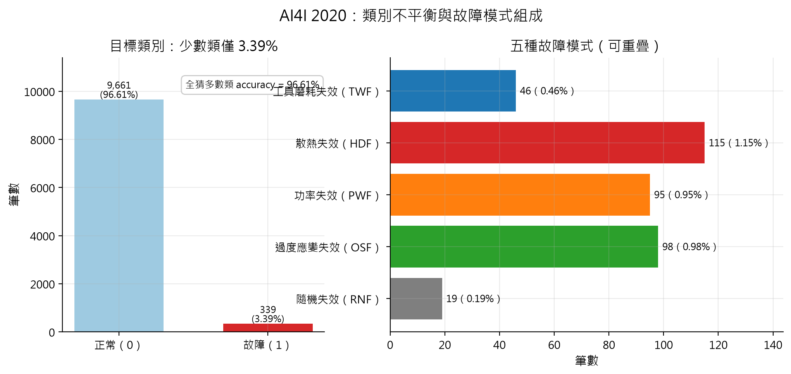

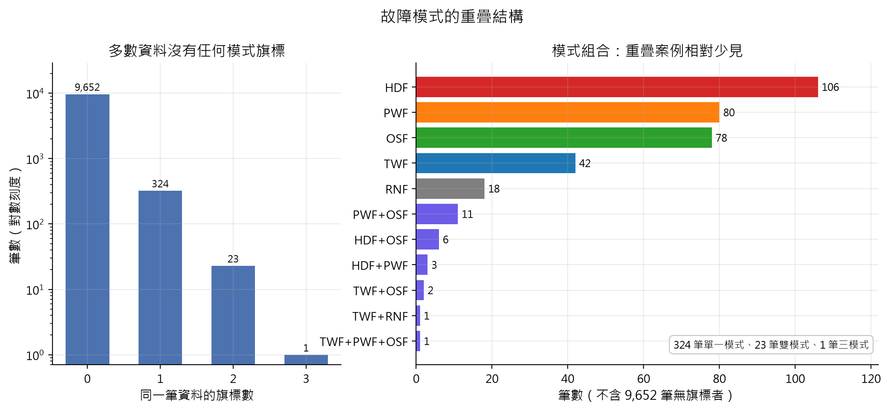

## 2. 特徵分布與模式剖面

- 五個感測特徵的邊際分布高度重疊，單一特徵不足以分離故障。
- 功率與溫差是少數具備清楚物理意義的衍生特徵，分別對應 PWF 與 HDF。
- RNF 的特徵偏移較小且方向不一致（|z| ≤ 0.8），符合隨機失效難以學習的預期；仍需在階段 5 以模型驗證是否僅為雜訊。

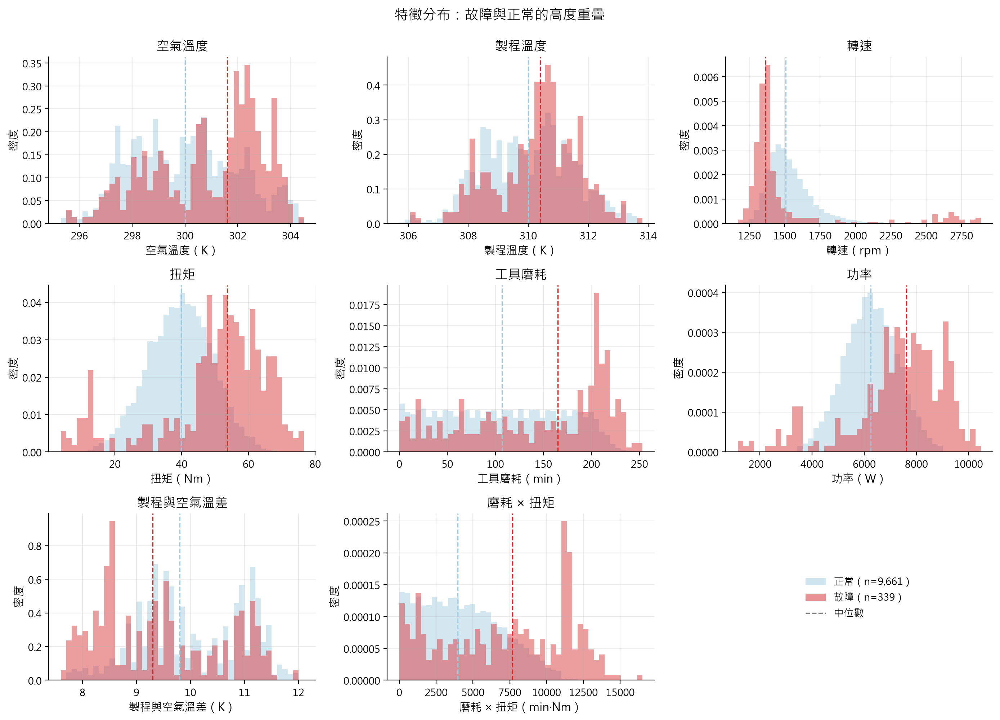

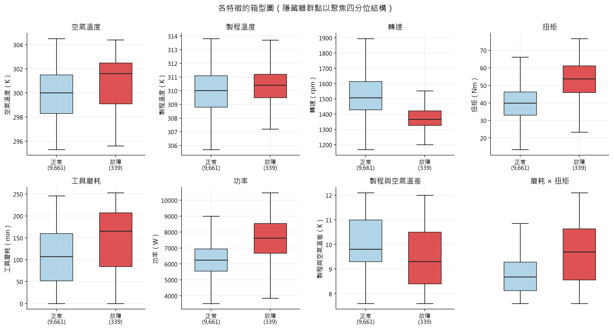

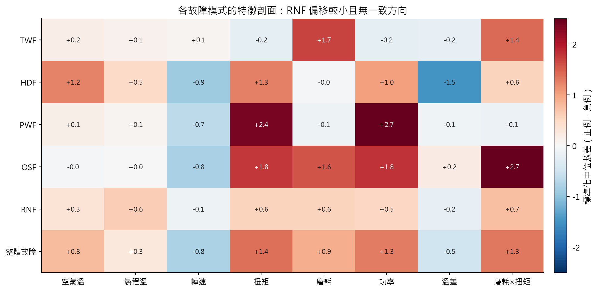

## 3. 相關性

| 特徵 | Pearson | Spearman |
| --- | ---: | ---: |
| 空氣溫 | +0.083 | +0.083 |
| 製程溫 | +0.036 | +0.040 |
| 轉速 | -0.044 | -0.167 |
| 扭矩 | +0.191 | +0.169 |
| 磨耗 | +0.105 | +0.102 |
| 功率 | +0.176 | +0.154 |
| 溫差 | -0.112 | -0.102 |
| 磨耗×扭矩 | +0.190 | +0.128 |

Pearson 假設線性關係、對極端值敏感，且二元目標在 3.39% 正例下會衰減係數；Spearman 只看單調性，較適合此處的初步篩選。兩者都只描述邊際關聯，會掩蓋「不同故障模式由不同特徵驅動」的異質性，因此不能取代分模式分析。

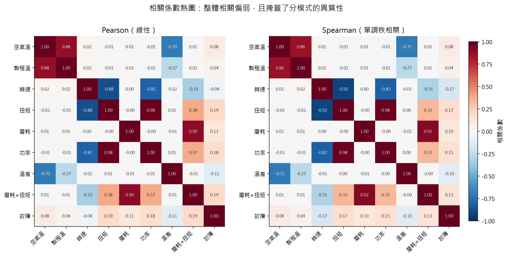

## 4. 物理邊界

- **PWF**：功率 < 3,500 W 或 > 9,000 W，規則命中 TP=95、FP=0、FN=0。
- **HDF**：溫差 < 8.6 K 且轉速 < 1,380 rpm，規則命中 TP=115、FP=0、FN=0。
- **OSF／TWF**：集中於高磨耗區，但 OSF 正例最低磨耗 172 min、TWF 最低 198 min，且有 TWF 超過 240 min；簡化磨耗窗不是必要條件。

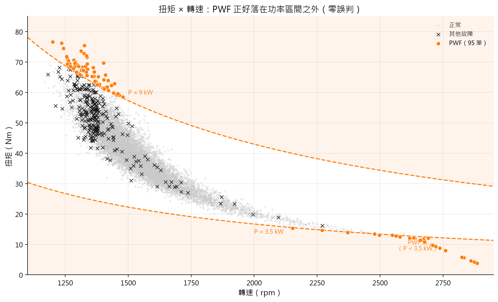

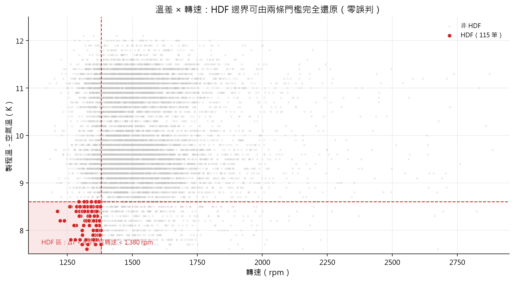

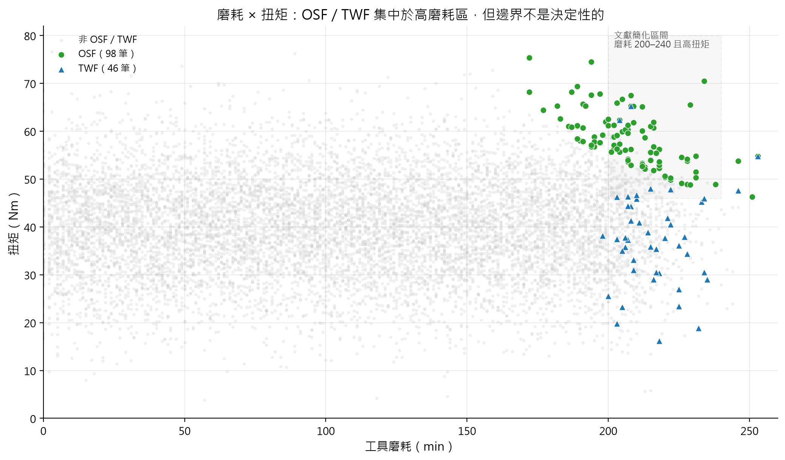

## 5. 機型與磨耗

| 機型 | 筆數 | 故障數 | 故障率 | 95% CI |
| --- | ---: | ---: | ---: | --- |
| L | 6,000 | 235 | 3.92% | 3.45–4.44% |
| M | 2,997 | 83 | 2.77% | 2.24–3.42% |
| H | 1,003 | 21 | 2.09% | 1.37–3.18% |

| 磨耗區間（min） | 筆數 | 故障數 | 故障率 | 95% CI |
| --- | ---: | ---: | ---: | --- |
| 0–50 | 2,349 | 52 | 2.21% | 1.69–2.89% |
| 50–100 | 2,271 | 51 | 2.25% | 1.71–2.94% |
| 100–150 | 2,290 | 52 | 2.27% | 1.74–2.97% |
| 150–200 | 2,289 | 61 | 2.66% | 2.08–3.41% |
| 200–240 | 787 | 119 | 15.12% | 12.79–17.79% |
| 240–260 | 14 | 4 | 28.57% | 11.72–54.65% |

邊際上 L 的故障率高於 H，但這不是「低階機型體質較差」的證據：機型的扭矩與轉速分布不同，且 200–240 min 分桶內 L 的故障率仍高於 H，顯示磨耗與操作條件共同作用。H 在 240 min 以上僅 3 筆，估計極不穩定。

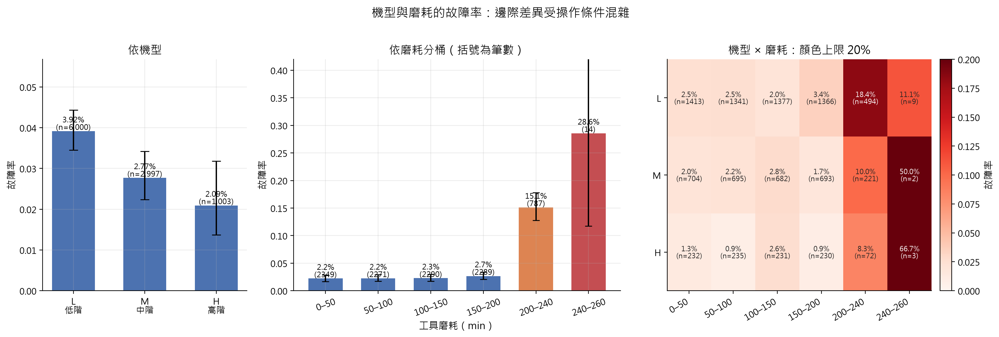

## 6. 磨耗序列

- 共 **119 次重置**、**120 個週期**，磨耗每次歸零。
- 週期長度平均 83.3 筆、中位數 84 筆（11–101）。
- 最大磨耗 253 min；重置前的磨耗最高 253 min。
- UDI 只是生成順序，不是真實時間；因此後續不以 UDI 作為特徵，但可用來做時間切分的穩健性對照。

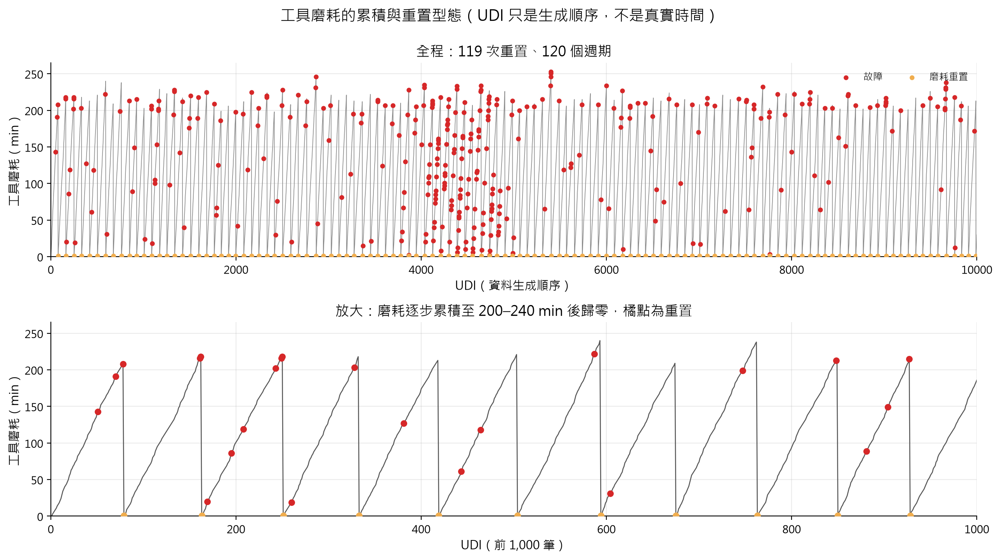

## 7. 重點觀察

1. 這是一份**合成資料**：PWF 與 HDF 可由規則完全還原，模型若在此拿下高分，代表它學到了生成規則，而非發現了新的物理現象。
2. 整體 PR-AUC 會被 HDF／PWF 這兩個「送分題」拉高，必須拆模式呈現。
3. OSF／TWF 的邊界重疊且含隨機成分，是較誠實的機器學習問題。
4. RNF 提供了一個天然的下限對照：任何模型都不該顯著優於隨機。
5. 類別不平衡使 accuracy 無意義；後續以 PR-AUC、recall@precision 與成本矩陣為主。

## 圖表清單

| 圖 | 檔案 |
| --- | --- |
| 類別不平衡 | `fig01_class_imbalance.png` |
| 模式重疊 | `fig02_mode_overlap.png` |
| 特徵分布 | `fig03_feature_distributions.png` |
| 箱型圖 | `fig04_feature_boxplots.png` |
| 模式剖面 | `fig05_mode_profile.png` |
| 相關性 | `fig06_correlation_heatmap.png` |
| PWF 邊界 | `fig07_power_boundary.png` |
| HDF 邊界 | `fig08_hdf_boundary.png` |
| 磨耗與扭矩 | `fig09_wear_torque.png` |
| 機型與磨耗 | `fig10_type_wear.png` |
| 磨耗序列 | `fig11_wear_sequence.png` |

## 已知資料問題

- RNF=1 但 target=0：18 筆。
- target=1 但沒有任何模式旗標：9 筆。
- 完整 UDI 清單見 `results/data_audit.md`。
