# 以主成分分析與多層感知器於 Iris 資料集之分類研究

**A Study on Iris Dataset Classification Using Principal Component Analysis and Multilayer Perceptron**

作者：26.ai.new 專案團隊  
日期：2026 年 10 月 23 日  
關鍵詞：Iris 資料集、主成分分析、多層感知器、類神經網路、分類、可重現性

---

## 摘要

本研究以 Fisher（1936）提出的 Iris 資料集為對象，建立一套可完整重現的資料分析與分類流程。資料共 150 筆、4 個連續型特徵與 3 個品種標籤，三個類別各 50 筆。研究首先從 UCI 官方來源取得原始資料，比對官方修正版後更正了兩筆流傳已久的數值錯誤，並完成缺失值、重複列、極端值、類別平衡、相關性與特徵區辨力檢查；接著以標準化後的資料進行主成分分析（PCA），前三個主成分分別解釋 72.96%、22.85% 與 3.67% 的變異量，累積達 99.48%，並據此繪製 PC1–PC3 的三維特徵分布圖與互動式視覺化。分類實驗採分層抽樣將資料分為 120 筆開發集與 30 筆測試集，在開發集上以 5-fold 交叉驗證比較四種多層感知器（MLP）架構與三種基準模型，依 macro-F1 選出「4-8-3」單隱藏層網路。最終模型在測試集上達到 90.0% 準確率（95% bootstrap 信賴區間 80.0%–100.0%）、macro-F1 0.900、ROC-AUC 0.993，setosa 全部正確，錯誤集中於 versicolor 與 virginica 的重疊地帶。以 10 個隨機種子重複訓練後，測試準確率為 88.3% ± 3.9%，顯示單一切分的結果存在相當的抽樣變異。研究結果呼應 Iris 資料的經典特性：setosa 線性可分，versicolor 與 virginica 在花瓣尺寸上連續重疊；同時顯示在此類小型、飽和且低維的表格資料上，類神經網路未必優於 SVM 等具明確歸納偏誤的模型。本文最後討論小樣本評估的效度威脅，並提出後續研究方向。

**Abstract.** This study presents a reproducible end-to-end pipeline for the Iris dataset, comprising data quality auditing, exploratory analysis, three-dimensional PCA visualization, and multilayer perceptron (MLP) classification. After correcting two long-standing transcription errors against the official Bézdek version, the 150 samples were analyzed. The first three principal components explained 72.96%, 22.85%, and 3.67% of the variance (99.48% cumulative). Using a stratified 80/20 split, four MLP architectures and three baselines were compared by five-fold cross-validation on the 120-sample development set. The selected 4-8-3 MLP achieved 90.0% test accuracy (95% bootstrap CI 80.0–100.0%), macro-F1 of 0.900, and ROC-AUC of 0.993. All setosa samples were correctly classified; errors were confined to the versicolor–virginica overlap. Across ten random seeds, test accuracy was 88.3% ± 3.9%, highlighting the sampling variability of a 30-sample test set. The results confirm the classical separability structure of Iris and suggest that, for small saturated tabular problems, neural networks offer no clear advantage over simpler inductive biases such as an RBF-SVM.

---

## 1. 緒論

### 1.1 研究背景

Iris 資料集由 Fisher 於 1936 年發表，包含三種鳶尾花（setosa、versicolor、virginica）各 50 筆，每筆記錄花萼長度、花萼寬度、花瓣長度與花瓣寬度四項測量值[1]。由於資料規模小、欄位直觀、類別平衡，且同時具備「容易分離」與「部分重疊」兩種特性，八十多年來一直是統計分類與機器學習的標準教材，也是檢驗新演算法與視覺化方法的常用基準[2]。

然而，正因為 Iris 過於經典，許多分析只停留在「呼叫套件、得到高準確率」的層次，較少完整交代資料從何而來、是否經過更正、測試集是否被重複使用，以及在小樣本下單一準確率的可信度。這些細節正是資料科學實務中最容易出錯、也最值得記錄的部分。

### 1.2 研究動機與目的

本研究的目的不是追求 Iris 上的最高分數，而是建立一個「從原始資料到可閱讀論文」的完整、可重現流程，並如實呈現模型的表現與限制。具體目標如下：

1. 從 UCI 官方來源取得資料，保留原始檔，完成資料品質檢查與已知勘誤，並將整理後的資料保存於專案中。
2. 說明欄位、特徵與分類標籤，進行探索式資料分析（EDA），並以 PCA 繪製三維特徵分布圖。
3. 建立多層感知器分類模型，適當切分訓練與測試資料，以交叉驗證選擇架構，完整評估並視覺化結果。
4. 依據實際實驗數據撰寫小論文，討論模型行為、錯誤型態、效度威脅與實務啟示。

### 1.3 研究範圍與貢獻

本研究的主要貢獻可歸納為四點：

- **資料追溯與勘誤**：保留 UCI 原始檔，並以官方 `bezdekIris.data` 為參照，記錄第 35、38 筆共 3 個數值的更正前後差異與 SHA-256，使資料處理可被稽核。
- **完整的視覺化分析**：從單變量分布、成對關係、相關係數到 PCA 三維分布，並提供可互動旋轉的 HTML 圖，補足靜態 3D 圖難以判讀深度的問題。
- **嚴謹的小樣本評估**：測試集僅在最終階段使用一次，並以 bootstrap 信賴區間、10 個隨機種子重複訓練、學習曲線與排列特徵重要性來呈現不確定性，而非只報告單一數字。
- **可重現的開源流程**：所有圖表與數字均由固定種子的程式產生，執行 `python run_all.py` 即可重建。

---

## 2. 文獻探討

### 2.1 Iris 與線性分類

Fisher 以線性判別分析（linear discriminant analysis）處理 Iris，證明四項測量可用來區分三個品種[1]。後續研究普遍指出：setosa 與另外兩類之間幾乎完全分離；versicolor 與 virginica 則在花瓣長度與寬度上存在連續重疊，是分類錯誤的主要來源。這項結構性事實意味著，任何模型在 Iris 上的表現都存在一個由資料本身決定的上限，而不只是演算法能力的問題。

### 2.2 主成分分析

PCA 由 Pearson 提出、Hotelling 加以發展，是一種以正交轉換尋找最大變異方向的線性降維方法[4]。Jolliffe 與 Cadima 回顧指出，PCA 適合用於探索資料結構、去除特徵共線性與視覺化，但主成分是原始特徵的線性組合，解釋性不如原始欄位直觀，且對尺度敏感，使用前通常需要標準化[5]。本研究以 PCA 作為視覺化工具，而非分類模型的輸入，以避免在解釋上混淆「降維」與「特徵工程」的角色。

### 2.3 多層感知器

多層感知器是一種前饋式類神經網路，透過隱藏層的非線性激活函數學習特徵交互作用，並以反向傳播計算梯度[6]。近年深度學習的進展顯示，類神經網路在資料量充足、維度高的任務上具有強大表現[7]，但在小型表格資料上，其優勢往往不明顯，且對初始化、正則化與超參數相當敏感。本研究採用 ReLU 激活、Adam 優化器[8]、L2 正則化與 early stopping，並以交叉驗證選擇網路寬度。Dropout[9] 雖然是常見的正則化手段，但在僅 120 筆的訓練資料上可能造成欠擬合，因此未納入主要實驗。

### 2.4 小樣本的模型評估

Dietterich 比較多種監督式學習演算法的統計檢定方法，指出在小測試集上，單次留出法（hold-out）的變異很大，交叉驗證與重複實驗較能反映真實差異[12]。Efron 與 Tibshirani 的 bootstrap 方法則可在不假設常態分布的情況下估計指標的信賴區間[11]。本研究同時採用這三種策略：交叉驗證做模型選擇、bootstrap 估計測試準確率的區間、多種子重複訓練觀察初始化變異。

---

## 3. 研究方法

### 3.1 資料來源與前處理

資料下載自 UCI Machine Learning Repository 的 Iris 資料集[2]，包含：

- `iris.data`：150 筆原始測量值；
- `bezdekIris.data`：UCI 提供的官方修正版；
- `iris.names`：欄位與資料背景說明。

原始檔與修正版逐值比對後，發現 2 筆記錄、共 3 個數值不一致（表 1）。這些差異是 Iris 資料流傳過程中著名的轉錄錯誤，本研究以官方修正版為準進行更正，但**保留未修改的原始檔**，僅將更正套用於 `data/iris.csv`，以便完整追溯。

**表 1　UCI 原始檔與官方修正版之差異**

| 筆數（1-based） | 欄位 | 原始值 | 更正後 |
| ---: | --- | ---: | ---: |
| 35 | 花瓣寬度 petal_width | 0.1 | 0.2 |
| 38 | 花萼寬度 sepal_width | 3.1 | 3.6 |
| 38 | 花瓣長度 petal_length | 1.5 | 1.4 |

更正後資料與 scikit-learn 內建版本[10]逐值一致。最終資料共 150 筆、4 個數值特徵與 1 個類別標籤，三個品種各 50 筆；無缺失值，完全重複列 1 筆（原始檔因錯誤而出現 3 筆重複）。重複列未被刪除，因為機器學習模型對重複樣本不敏感，且刪除會改變類別平衡與資料的原始樣貌。

**表 2　資料欄位說明**

| 欄位 | 中文名稱 | 型態 | 單位 | 說明 |
| --- | --- | --- | --- | --- |
| `sepal_length` | 花萼長度 | 連續 | cm | 花萼（sepals）的縱向長度 |
| `sepal_width` | 花萼寬度 | 連續 | cm | 花萼的橫向寬度 |
| `petal_length` | 花瓣長度 | 連續 | cm | 花瓣（petals）的縱向長度 |
| `petal_width` | 花瓣寬度 | 連續 | cm | 花瓣的橫向寬度 |
| `species` | 品種 | 類別 | — | setosa、versicolor、virginica |

本研究以 80/20 分層抽樣切分資料：120 筆作為開發集（用於交叉驗證、模型選擇與最終訓練），30 筆作為測試集（每類 10 筆），測試集僅在最終評估時使用一次。所有需要學習參數的轉換（標準化、PCA）在建模流程中皆包在 `Pipeline` 內，於交叉驗證的各折內自行擬合，避免測試資訊洩漏。唯獨第 4.2 節的 PCA 視覺化與第 4.3 節以前的 EDA 使用全部 150 筆，屬於非監督的探索性分析，不涉及標籤與模型選擇。

### 3.2 探索式資料分析

分析內容包括：

1. **資料完整性**：缺失值、完全重複列、欄位型態與值域。
2. **敘述統計**：平均數、標準差、四分位數、最小值、最大值與變異係數。
3. **類別平衡**：各品種筆數與比例。
4. **極端值**：以 1.5 倍四分位距（IQR）規則標記。Iris 的極端值多為真實生物個體差異，因此僅標記、不刪除，以免損失資訊。
5. **特徵關聯**：Pearson 相關係數矩陣；以單因子變異數分析（ANOVA F 檢定）與互資訊（mutual information）衡量各特徵對品種的區辨力。
6. **視覺化**：類別分布圖、分組直方圖、箱型圖、相關係數熱圖與成對散點圖。

### 3.3 主成分分析與三維視覺化

令 $X \in \mathbb{R}^{150 \times 4}$ 為原始特徵矩陣。首先對每個特徵做 z-score 標準化：

$$
Z_{ij} = \frac{X_{ij} - \bar{X}_j}{s_j},
$$

其中 $\bar{X}_j$ 與 $s_j$ 分別為第 $j$ 個特徵的平均數與標準差。接著對 $Z$ 的共變異數矩陣做特徵分解，取得主成分方向。第 $k$ 個主成分的解釋變異量比例為

$$
\mathrm{EVR}_k = \frac{\lambda_k}{\sum_{m=1}^{4} \lambda_m},
$$

其中 $\lambda_k$ 為第 $k$ 個特徵值。本研究保留四個主成分，並以 PC1、PC2、PC3 為座標軸繪製 3D 散點圖；圖中顏色代表品種，另以 Plotly 輸出可拖曳旋轉、滾輪縮放的互動式 HTML。主成分負荷量（loading）定義為原始特徵與主成分的相關係數方向，用於解釋每個主成分的物理意義。

### 3.4 多層感知器分類模型

本研究使用 scikit-learn 的 `MLPClassifier`[10]，網路結構為「輸入層 4 節點 → 隱藏層 → 輸出層 3 節點」。輸入為標準化後的四項測量值，輸出層使用 softmax 產生三個品種的機率。訓練目標為正則化交叉熵：

$$
\mathcal{L} = -\frac{1}{N}\sum_{i=1}^{N}\sum_{c=1}^{3} y_{ic}\log \hat{p}_{ic}
+ \frac{\alpha}{2}\sum_{l}\lVert W^{(l)} \rVert_F^2,
$$

其中 $\alpha$ 為 L2 正則化係數。優化器為 Adam[8]，初始學習率 0.01，批次大小 32，激活函數為 ReLU。為避免過度訓練，最終模型啟用 early stopping：從開發集再切出 15%（18 筆）作為內部驗證集，若驗證準確率連續 50 個 epoch 未改善即停止，最多訓練 3000 個 epoch。

### 3.5 實驗設計

**模型選擇。** 在 120 筆開發集上以 5-fold 分層交叉驗證比較下列模型：

- 4 種 MLP：8、16-8、32-16、16（α = 0.01）個隱藏節點；
- 3 種基準模型：邏輯迴歸、RBF 核 SVM、k = 5 的 k 最近鄰。

所有模型皆含標準化。以 macro-F1 為主要選擇指標，因為三個類別同樣重要；準確率與 log loss 作為輔助參考。為避免測試集洩漏，基準模型在測試集上的分數僅作為描述性對照，不參與模型選擇。

**最終評估。** 選定架構後，於完整開發集重新訓練，並在 30 筆測試集上計算：

- 準確率、平衡準確率、macro-F1、加權 F1；
- log loss、One-vs-Rest ROC-AUC（macro 與 micro）；
- Cohen's kappa、Matthews 相關係數（MCC）；
- 混淆矩陣與各類別 precision / recall / F1。

**不確定性分析。**

1. 以 2,000 次 bootstrap 重抽測試集，計算準確率的 95% 百分位信賴區間[11]。
2. 以 10 個不同隨機種子重複訓練同一架構（資料切分固定），觀察初始化與批次順序造成的變異。
3. 繪製學習曲線，觀察訓練樣本數與表現的關係。
4. 以測試集上的排列特徵重要性（permutation importance，50 次重抽）檢視模型對各特徵的依賴程度，並明確標示其探索性質。

**實作環境。** Python 3.14.4、NumPy 2.5.4、pandas 3.1.0、scikit-learn 1.9.1、Matplotlib 3.11.2、seaborn 0.13.2、Plotly 7.1.0。所有隨機程序固定 seed = 42（多種子實驗除外）。

---

## 4. 實驗結果

### 4.1 探索式資料分析

圖 1 顯示三個品種各 50 筆，類別完全平衡；圖 2 與圖 3 則呈現四項特徵的分布。setosa 的花瓣長度與寬度明顯小於另外兩類，分布幾乎不重疊；versicolor 與 virginica 的花瓣特徵則連續相接，邊界模糊。花萼特徵的重疊程度更高，單獨使用花萼寬度幾乎無法區分 versicolor 與 virginica。

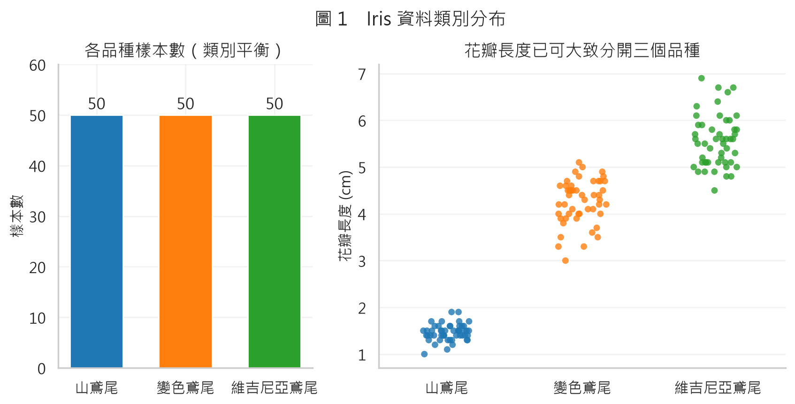

*圖 1　三個品種各 50 筆，類別完全平衡；花瓣長度已能大致分開 setosa 與其餘兩類。*

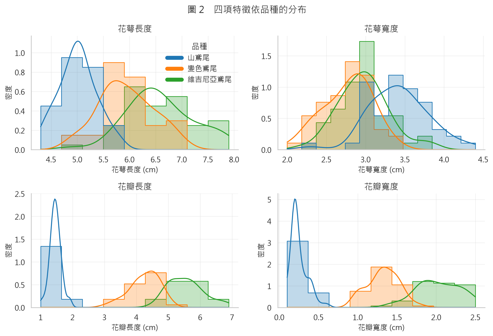

*圖 2　花瓣特徵呈雙峰／多峰分布，反映品種間的差異；花萼特徵重疊較多。*

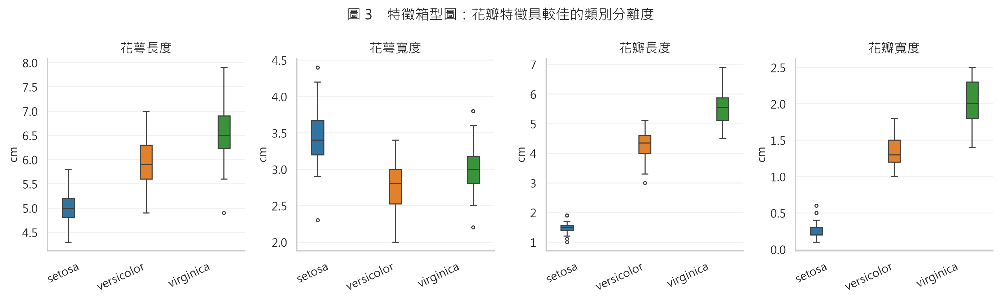

*圖 3　箱型圖顯示花瓣長度與寬度的類別分離度最佳，花萼寬度最差。*

**表 3　敘述統計（n = 150）**

| 特徵 | 平均 | 標準差 | 最小 | Q1 | 中位數 | Q3 | 最大 | 變異係數 |
| --- | ---: | ---: | ---: | ---: | ---: | ---: | ---: | ---: |
| 花萼長度 | 5.843 | 0.828 | 4.3 | 5.10 | 5.80 | 6.40 | 7.9 | 0.142 |
| 花萼寬度 | 3.057 | 0.436 | 2.0 | 2.80 | 3.00 | 3.30 | 4.4 | 0.143 |
| 花瓣長度 | 3.758 | 1.765 | 1.0 | 1.60 | 4.35 | 5.10 | 6.9 | 0.470 |
| 花瓣寬度 | 1.199 | 0.762 | 0.1 | 0.30 | 1.30 | 1.80 | 2.5 | 0.636 |

花瓣特徵的變異係數（0.470、0.636）遠高於花萼特徵（約 0.14），表示花瓣尺寸在樣本間的相對差異更大，這也是它更具區辨力的原因之一。以 1.5×IQR 規則標記的極端值共 4 筆，皆落在合理生物範圍內，故保留。

**表 4　特徵與品種的關聯強度**

| 特徵 | ANOVA F 值 | p 值 | 互資訊 |
| --- | ---: | ---: | ---: |
| 花萼長度 | 119.26 | 1.67 × 10⁻³¹ | 0.511 |
| 花萼寬度 | 49.16 | 4.49 × 10⁻¹⁷ | 0.299 |
| 花瓣長度 | 1180.16 | 2.86 × 10⁻⁹¹ | 0.993 |
| 花瓣寬度 | 960.01 | 4.17 × 10⁻⁸⁵ | 0.986 |

四項特徵的 p 值皆遠小於 0.001，但效果量差異明顯：花瓣長度的 F 值（1180.16）與互資訊（0.993）最高，花萼寬度最低。這與圖 2、圖 3 的視覺印象一致。

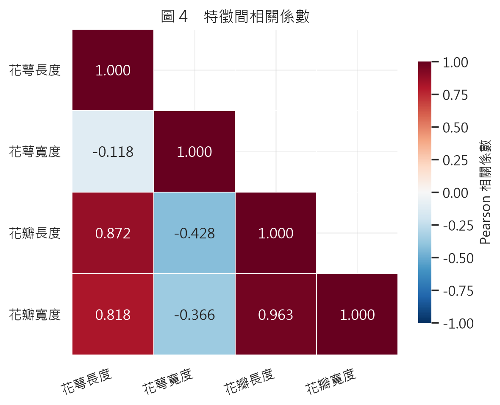

*圖 4　花瓣長度與花瓣寬度高度相關（r = 0.963），花萼寬度則與花瓣特徵呈弱負相關。*

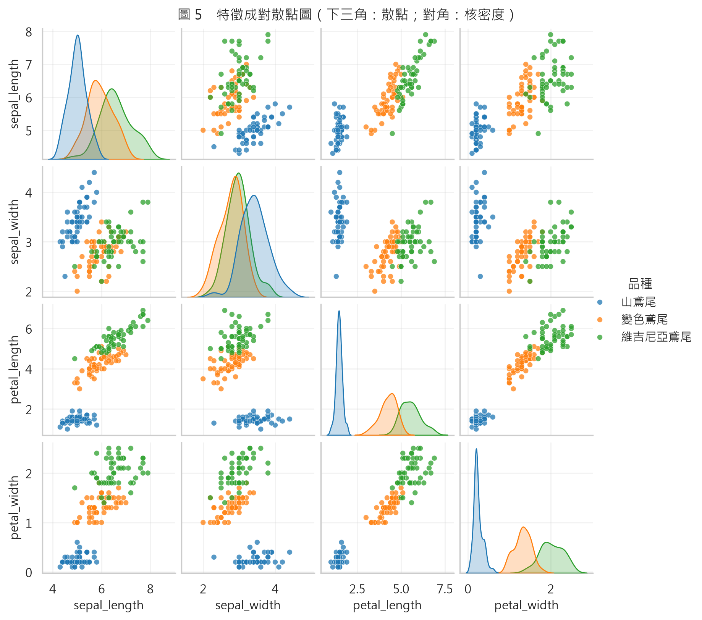

*圖 5　成對散點圖：以花瓣長度與寬度構成的平面上，setosa 完全分離，versicolor 與 virginica 僅部分重疊。*

相關係數方面，花瓣長度與花瓣寬度達 r = 0.963，花萼長度與花瓣長度亦有 r = 0.872，顯示特徵間存在明顯共線性，這也是 PCA 能以少數主成分保留大部分變異的原因。花萼寬度與其他三項特徵皆呈負相關（−0.118 至 −0.428），在 PCA 中形成獨立的方向。

### 4.2 主成分分析

標準化後進行 PCA，四個主成分的解釋變異量與累積比例如表 5。前兩個主成分即保留 95.81% 的變異，前三個達 99.48%，第四個僅剩 0.52%。圖 6 的陡坡圖清楚顯示「肘部」出現在 PC2 之後。

**表 5　PCA 解釋變異量**

| 主成分 | 特徵值 | 解釋變異量 | 累積解釋變異量 |
| --- | ---: | ---: | ---: |
| PC1 | 2.918 | 72.96% | 72.96% |
| PC2 | 0.914 | 22.85% | 95.81% |
| PC3 | 0.147 | 3.67% | 99.48% |
| PC4 | 0.021 | 0.52% | 100.00% |

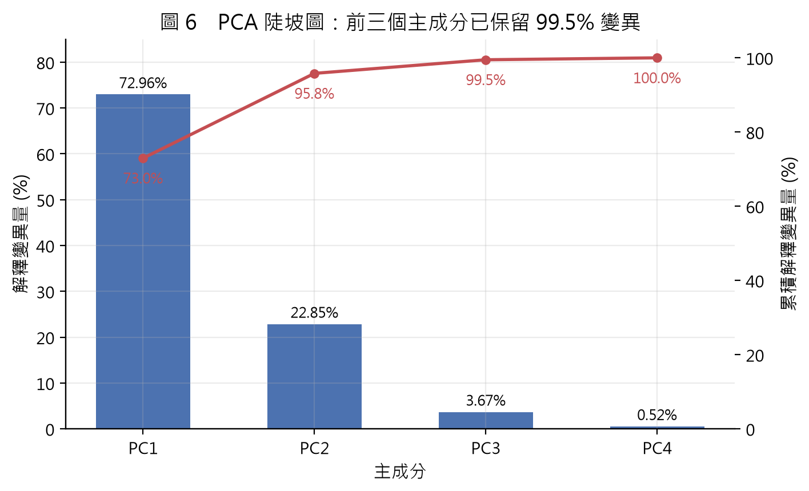

*圖 6　前三個主成分累積解釋 99.48% 的變異，第四個主成分幾乎不帶資訊。*

**表 6　主成分負荷量**

| 特徵 | PC1 | PC2 | PC3 |
| --- | ---: | ---: | ---: |
| 花萼長度 | 0.521 | 0.377 | 0.720 |
| 花萼寬度 | −0.269 | 0.923 | −0.244 |
| 花瓣長度 | 0.580 | 0.024 | −0.142 |
| 花瓣寬度 | 0.565 | 0.067 | −0.634 |

PC1 在花萼長度、花瓣長度與花瓣寬度上皆為正載荷（0.521、0.580、0.565），可詮釋為「整體花朵尺寸」；PC2 幾乎由花萼寬度主導（0.923），且與花瓣尺寸方向相反，形成「寬花萼 vs. 大花瓣」的對比；PC3 則主要區分花萼長度（0.720）與花瓣寬度（−0.634）的細微差異。由於 PC3 僅解釋 3.67% 的變異，其視覺分離效果有限。

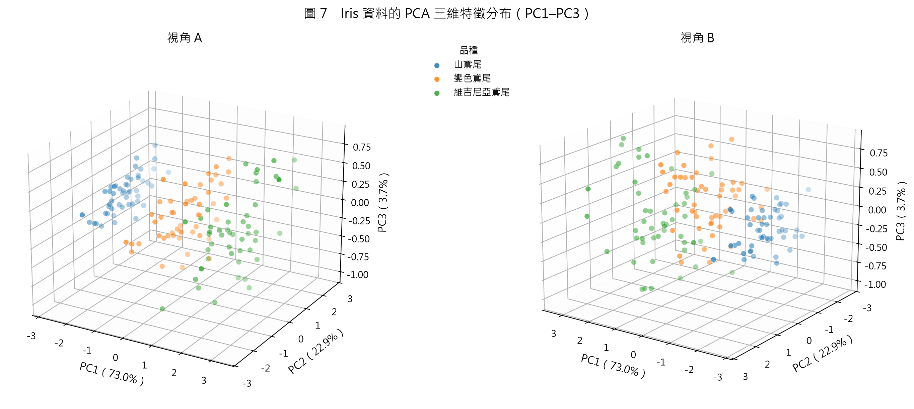

*圖 7　PC1–PC3 三維散布圖（兩個視角）。setosa 形成獨立群集；versicolor 與 virginica 在 PC1–PC2 平面上部分重疊，PC3 只提供少量額外分離。*

三維圖顯示，setosa 在 PC1 上與其他兩類明顯分開；versicolor 與 virginica 的主體雖然沿 PC1 有先後次序，但在交界處互相交錯。即使把 PC3 納入，兩類仍有重疊，這預告了後續分類錯誤的型態。互動式版本（`figures/fig08_pca_3d_interactive.html`）可讓讀者自由旋轉視角、懸停查看單筆樣本的四項原始測量值，比靜態圖更容易觀察三維結構。

### 4.3 模型選擇

表 7 為 5-fold 交叉驗證結果（開發集 120 筆）。四種 MLP 的準確率介於 95.00% 至 96.67%，macro-F1 介於 0.9496 至 0.9663；最佳者為單隱藏層 8 節點的 MLP-8（0.9667 ± 0.0349、macro-F1 0.9663）。值得注意的是，RBF-SVM 的交叉驗證表現與 MLP-8 幾乎相同（0.9667 ± 0.0186、macro-F1 0.9665），而邏輯迴歸、kNN 與其他 MLP 也都在 95.83% 左右。也就是說，在這個已經高度飽和的資料集上，模型之間的差距只有 1 至 2 筆樣本，已接近交叉驗證的解析度極限。

**表 7　5-fold 交叉驗證結果（開發集 n = 120）**

| 模型 | 準確率 | Macro-F1 | Log loss | 測試集準確率（對照） |
| --- | ---: | ---: | ---: | ---: |
| **MLP-8（選定）** | **0.9667 ± 0.0349** | **0.9663** | **0.1103** | **0.9000** |
| SVM (RBF) | 0.9667 ± 0.0186 | 0.9665 | 0.1228 | 0.9667 |
| MLP-32-16 | 0.9583 ± 0.0295 | 0.9580 | 0.3051 | — |
| 邏輯迴歸 | 0.9583 ± 0.0295 | 0.9580 | 0.1625 | 0.9333 |
| MLP-16（α=0.01） | 0.9583 ± 0.0295 | 0.9580 | 0.2043 | — |
| kNN (k=5) | 0.9583 ± 0.0295 | 0.9580 | 0.4041 | 0.9333 |
| MLP-16-8 | 0.9500 ± 0.0186 | 0.9496 | 0.2336 | — |

*註：測試集欄位僅供描述性對照，未參與模型選擇；「—」表示該模型未被選為最終模型，因此未單獨評估。*

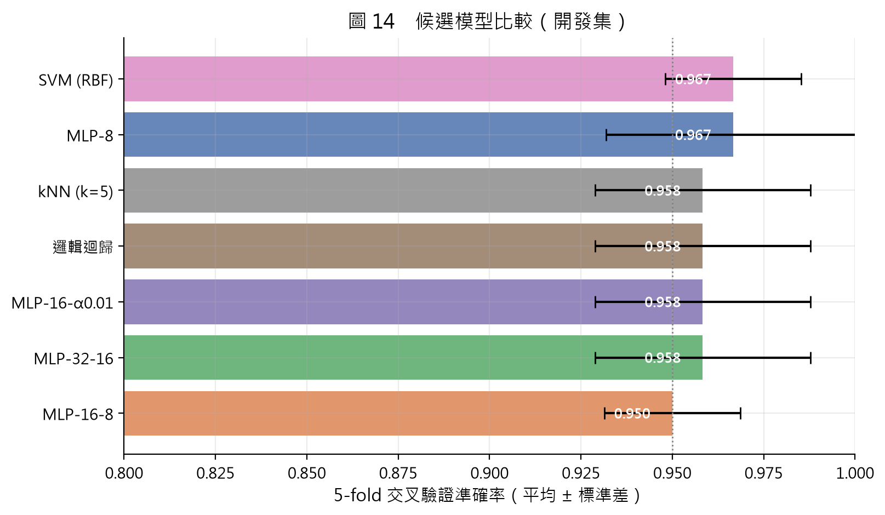

*圖 14　候選模型的交叉驗證準確率（誤差線為 ±1 標準差）。所有模型皆在 95% 以上，差異有限。*

選擇 MLP-8 而非更大的網路，有兩個理由：其交叉驗證 macro-F1 最高，且參數最少（4×8 + 8×3 + 偏置共 67 個可訓練參數），在僅 120 筆資料的情況下較不容易過擬合。這也符合「小型表格資料應優先考慮簡單模型」的一般經驗。

### 4.4 最終模型訓練

最終模型在開發集上訓練 100 個 epoch 後觸發 early stopping（最佳驗證準確率 0.944，出現在第 49 個 epoch；之後 50 個 epoch 未再改善）。訓練損失由 1.0995 降至 0.0502，顯示模型已充分擬合訓練資料。

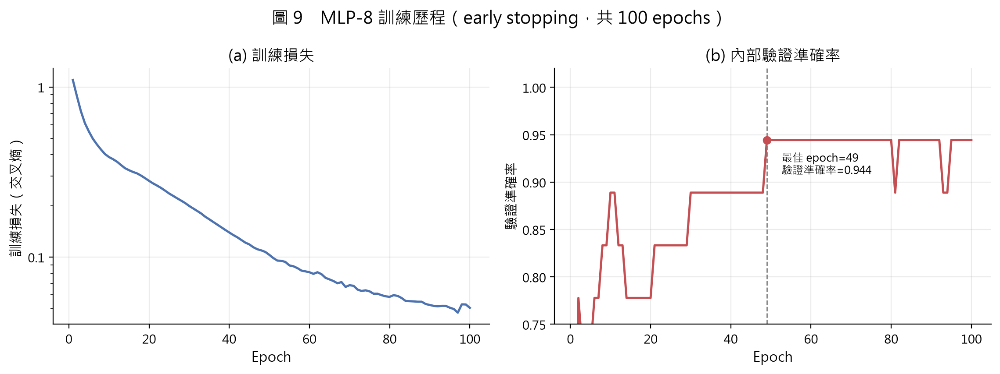

*圖 9　(左) 訓練損失隨 epoch 下降；(右) 內部驗證準確率。最佳驗證準確率為 0.944（epoch 49），之後進入高原期。*

圖 9 的驗證曲線在 epoch 20 之後快速上升，於 0.90–0.94 之間波動。由於內部驗證集僅 18 筆，每答對或答錯一題就會造成 5.6 個百分點的跳動，因此曲線的鋸齒狀波動主要是樣本數太少所致，而非訓練不穩定。

### 4.5 測試集表現

最終模型在 30 筆測試集上答對 27 筆，準確率 90.0%，95% bootstrap 信賴區間為 80.0%–100.0%。各項指標整理於表 8。

**表 8　測試集評估結果（n = 30）**

| 指標 | 數值 |
| --- | ---: |
| 準確率 | 0.9000（95% CI 0.8000–1.0000） |
| 平衡準確率 | 0.9000 |
| Macro-F1 | 0.8997 |
| 加權 F1 | 0.8997 |
| Log loss | 0.1855 |
| ROC-AUC（OvR macro） | 0.9933 |
| Cohen's kappa | 0.8500 |
| MCC | 0.8514 |

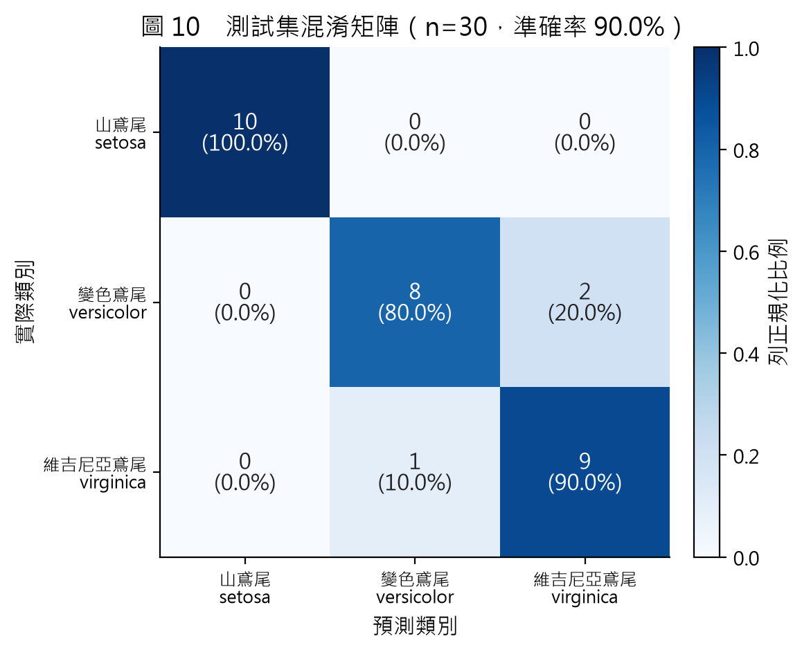

*圖 10　混淆矩陣（括號內為列正規化比例）。setosa 10/10 全數正確；versicolor 有 2 筆誤判為 virginica；virginica 有 1 筆誤判為 versicolor。*

**表 9　各品種分類指標**

| 品種 | Precision | Recall | F1 | 支持數 |
| --- | ---: | ---: | ---: | ---: |
| setosa（山鳶尾） | 1.0000 | 1.0000 | 1.0000 | 10 |
| versicolor（變色鳶尾） | 0.8889 | 0.8000 | 0.8421 | 10 |
| virginica（維吉尼亞鳶尾） | 0.8182 | 0.9000 | 0.8571 | 10 |
| **Macro 平均** | **0.9024** | **0.9000** | **0.8997** | **30** |

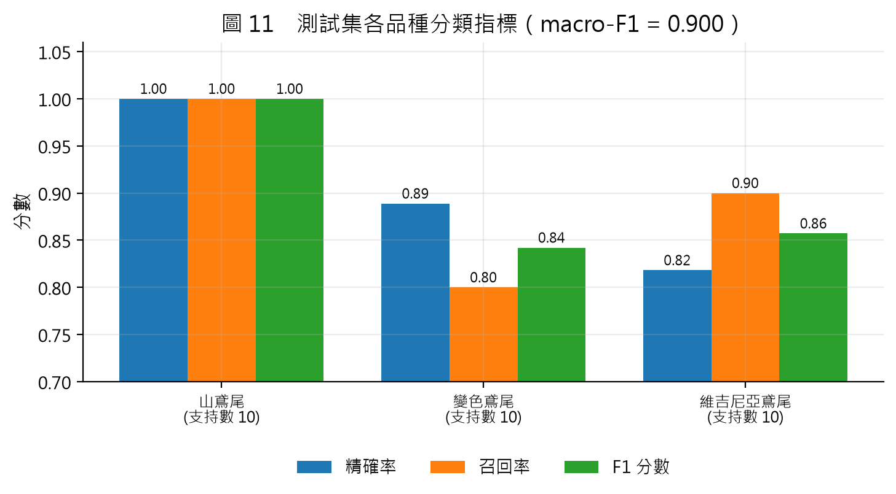

*圖 11　各品種的 precision、recall 與 F1。setosa 完美，versicolor 的召回率最低（0.80）。*

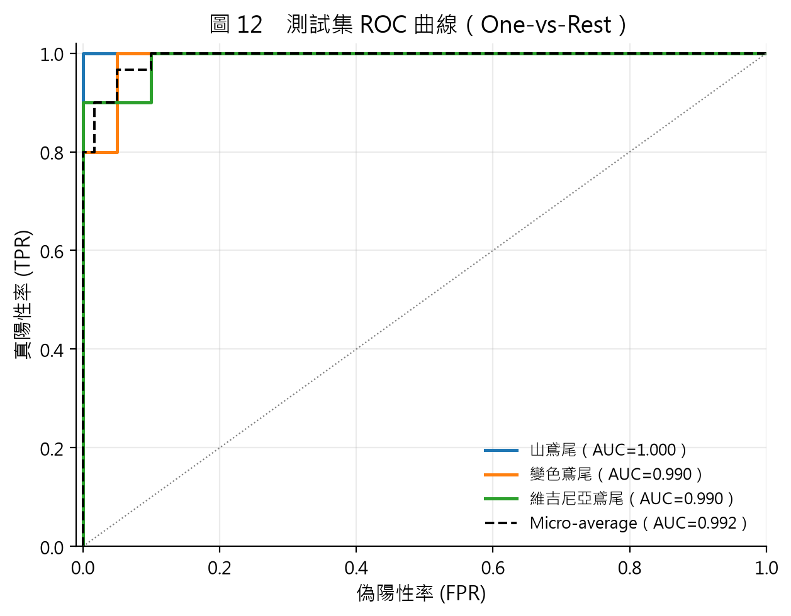

*圖 12　One-vs-Rest ROC 曲線。三類的曲線都非常靠近左上角；micro-average AUC 為 0.992。*

雖然準確率「只有」90%，ROC-AUC 卻高達 0.993，log loss 為 0.186。這代表模型對多數樣本的排序能力很好，錯誤主要發生在少數位於決策邊界、機率接近 0.5 的樣本，而非系統性的大範圍誤判。表 10 列出三筆誤判樣本。

**表 10　誤判樣本分析（測試集序號）**

| 測試集序號 | 實際品種 | 預測品種 | 花萼長 | 花萼寬 | 花瓣長 | 花瓣寬 | 預測信心 |
| ---: | --- | --- | ---: | ---: | ---: | ---: | ---: |
| 6 | versicolor | virginica | 6.3 | 3.3 | 4.7 | 1.6 | 0.580 |
| 24 | virginica | versicolor | 6.1 | 2.6 | 5.6 | 1.4 | 0.542 |
| 26 | versicolor | virginica | 6.7 | 3.0 | 5.0 | 1.7 | 0.740 |

三筆誤判的預測信心分別為 0.542、0.580、0.740，全部低於正確樣本的平均信心（0.919）；錯誤樣本的平均信心為 0.621。這表示模型在不確定時確實給出較低的機率，具備一定的「知道自己不確定」的能力（儘管未經正式機率校準）。從特徵來看，三筆的花瓣長度（4.7、5.0、5.6 cm）都落在 versicolor 與 virginica 的交界區，與 EDA 的觀察完全吻合。

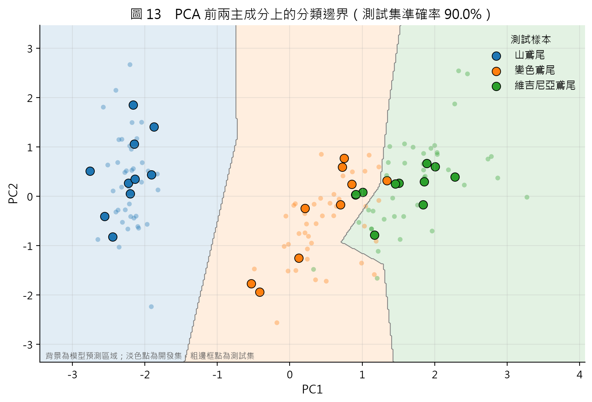

*圖 13　以 PC1、PC2 訓練的同架構模型之決策區域。背景為預測類別，淡色點為開發集，粗邊框點為測試集。即使只使用兩個主成分，測試準確率仍為 90.0%，與四維模型相同。*

圖 13 將開發集投影到前兩個主成分，並在該二維空間重新訓練同架構的 MLP，得到 90.0% 的測試準確率，與使用全部四維特徵的結果相同。這說明 PC3 雖然讓三維圖看起來更「立體」，但對分類幾乎沒有貢獻；Iris 的類別結構基本上是一個二維問題。

### 4.6 穩定性與特徵重要性

單一 80/20 切分的 90.0% 是否穩定？圖 17 與表 11 顯示，固定資料切分、只改變初始化與批次順序，10 次訓練的測試準確率為 88.3% ± 3.9%（範圍 80.0%–93.3%）。換言之，若當初換一個隨機種子，測試準確率可能落在 80% 到 93% 之間；90.0% 只是這個分布中的一個點。

**表 11　10 個隨機種子的測試表現**

| 統計量 | 數值 |
| --- | ---: |
| 平均準確率 | 0.8833 |
| 標準差 | 0.0393 |
| 最小值 | 0.8000 |
| 最大值 | 0.9333 |
| 訓練 epoch 數範圍 | 56–100 |

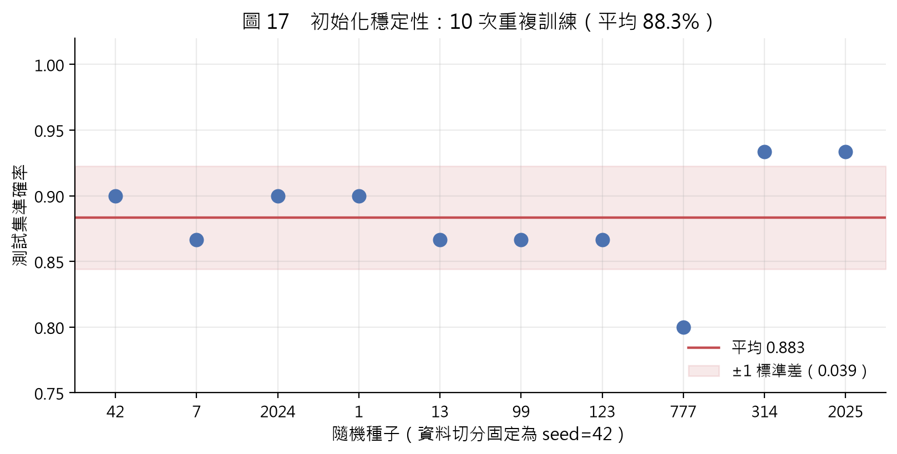

*圖 17　10 個隨機種子的測試準確率。紅線為平均，陰影為 ±1 標準差。*

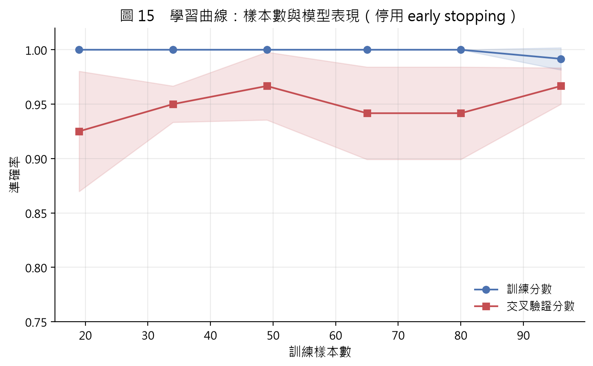

*圖 15　學習曲線（此圖停用 early stopping 以觀察樣本數效果）。訓練分數接近 1.0，交叉驗證分數在 92.5%–96.7% 之間；曲線在 50 筆之後趨於平坦，顯示資料量已接近此模型的飽和點。*

學習曲線顯示，訓練分數在各種樣本數下都接近 100%，交叉驗證分數在 19 筆時為 92.5%，之後介於 92% 至 97% 之間，並未隨資料增加而明顯提升。這是典型的「模型容量相對資料量過剩」現象：8 個隱藏節點已足以記住 120 筆資料的細節，增加資料帶來的邊際效益有限。

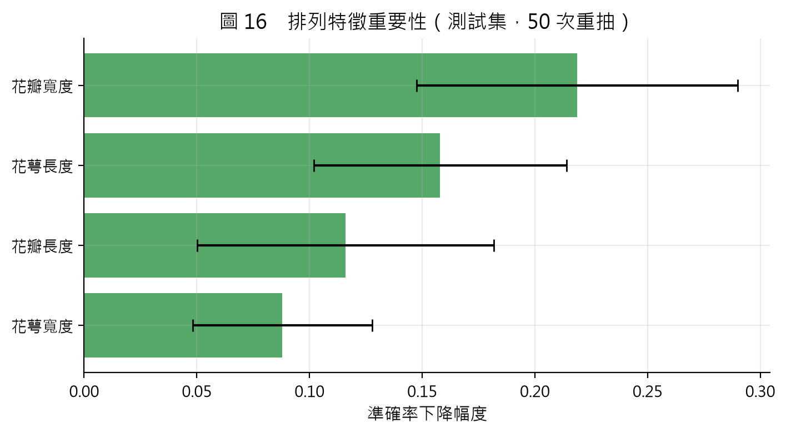

*圖 16　測試集上的排列特徵重要性（誤差線為 50 次重抽的標準差）。花瓣寬度最重要，花萼寬度最不重要。*

排列特徵重要性（表 12）顯示，花瓣寬度的影響最大（0.219），其次為花萼長度（0.158）、花瓣長度（0.116），花萼寬度最低（0.088）。花瓣寬度的重要性與 EDA 一致；花萼長度的重要性偏高，可能是因為它與花瓣長度高度相關（r = 0.872），當花瓣特徵被隨機打亂時，模型仍可從花萼長度取得部分替代資訊，使「打亂單一特徵」的傷害被低估或轉移。這也提醒我們：在特徵相關性高時，permutation importance 不應被詮釋為因果效果。

**表 12　排列特徵重要性（測試集，50 次重抽）**

| 特徵 | 平均準確率下降 | 標準差 |
| --- | ---: | ---: |
| 花瓣寬度 | 0.2187 | 0.0712 |
| 花萼長度 | 0.1580 | 0.0561 |
| 花瓣長度 | 0.1160 | 0.0657 |
| 花萼寬度 | 0.0880 | 0.0399 |

### 4.7 與基準模型的比較

表 7 已列出交叉驗證與測試集的對照。若僅看測試集，RBF-SVM 的 96.7% 高於 MLP 的 90.0%，邏輯迴歸與 kNN 為 93.3%。但這個比較必須非常小心：

1. 測試集只有 30 筆，一個樣本等于 3.33 個百分點；96.7% 與 90.0% 的差距只是 2 筆樣本。
2. 基準模型未經超參數調校，MLP 則是依交叉驗證選出的；即使如此，MLP 仍未在測試集上勝出。
3. 交叉驗證時 MLP-8 與 SVM 的準確率同為 96.7%，macro-F1 差值僅 0.0002，統計上不可區分。

因此，本研究**不能**主張「MLP 比 SVM 差」，只能說「在這個資料集與此實驗設計下，MLP 沒有展現優勢」。對小型表格資料而言，這其實是常見且合理的結果。

---

## 5. 討論

### 5.1 錯誤型態的意義

三個錯誤全部發生在 versicolor 與 virginica 之間，且都位於花瓣長度 4.7–5.6 cm、花瓣寬度 1.4–1.7 cm 的交界帶。這與 Fisher 以來的觀察一致：setosa 在花瓣尺寸上與其他兩類幾乎不重疊，而 versicolor 與 virginica 的分布是連續的，任何硬性決策邊界都必然在交界處產生錯誤[1]。換句話說，這 3 個錯誤不是模型「學不好」，而是資料本身在此區域的條件分布高度重疊。

模型的機率輸出也支持這個詮釋：正確樣本的平均預測信心為 0.919，錯誤樣本僅 0.621。模型對邊界樣本給出接近 0.5 的機率，對典型樣本則給出接近 1.0 的機率，表示它學到的不是死記標籤，而是某種與資料結構相符的連續函數。

### 5.2 為何 MLP 沒有勝過 SVM？

可能的原因有四：

1. **樣本量與歸納偏誤。** MLP 的假設空間很大，需要大量資料才能穩定估計；RBF-SVM 則以最大邊界與核函數隱含平滑性，對於 120 筆、二維本質的資料而言，是更強的歸納偏誤（inductive bias）。在小型資料上，較強的偏誤往往比更大的容量更有幫助。
2. **超參數搜尋空間有限。** 本研究只比較四種寬度與三種正則化組合，未對學習率、批次大小、激活函數做完整網格搜尋；SVM 也只用了預設的 C 與 gamma。兩者的調參程度不對等，但這反映的是「實務上有限資源下的合理選擇」，而非演算法的本質優劣。
3. **Early stopping 的變異。** 內部驗證集只有 18 筆，最佳 epoch 的判定容易受少數樣本影響。多種子實驗中 epoch 數介於 56–100，正是這種變異的表現。
4. **資料飽和。** 交叉驗證中所有模型都在 95% 以上，剩下的差距主要是標籤雜訊與邊界樣本，而非模型能力。此時比較模型的重點應轉向校準、穩定性與可解釋性，而不是準確率的小數點。

### 5.3 PCA 三維圖的資訊與限制

PCA 前三個主成分保留 99.48% 的變異，但 PC3 只占 3.67%。三維圖之所以看起來有「深度」，主要是因為 PC3 把極少數邊界樣本稍微推開，而不是形成新的群集。圖 13 的實驗也顯示，只用 PC1–PC2 的分類表現與四維模型相同。因此，3D 視覺化適合用來溝通資料結構與展示互動技術，但不應被誤認為「三維一定比二維好」。

此外，PCA 是線性、非監督的降維，主成分方向由整體變異決定，不一定對應最具區辨力的方向。在本例中，PC1 恰好與品種高度相關，是因為花瓣尺寸同時是變異最大、也最具區辨力的特徵；若換一個資料集，最大的變異方向未必有助於分類。這是使用 PCA 做視覺化時必須保留的保留態度。

### 5.4 效度威脅與研究限制

本研究結果應在下列限制下解讀：

1. **測試集過小。** 30 筆樣本的 95% 信賴區間寬達 20 個百分點；單一 90.0% 不應被視為模型真實能力的精確估計。多種子實驗（88.3% ± 3.9%）提供了更誠實的圖像。
2. **單一切分。** 本研究只用一個 80/20 切分。雖然模型選擇在開發集內以交叉驗證進行，但測試集本身仍是一次抽樣；不同的切分可能得到不同結果。
3. **超參數搜尋不完整。** 四種 MLP 架構只是小型網格，未使用貝氏優化或隨機搜尋；基準模型也未調參。這限制了「模型比較」的強度。
4. **視覺化的資料使用。** 圖 6–8 的 PCA 使用全部 150 筆資料（非監督），嚴格來說包含測試樣本；但這些圖不參與模型選擇或評估。圖 13 的 PCA 與分類器則只在開發集上擬合，測試集僅做轉換，無洩漏。
5. **特徵重要性的探索性。** 排列重要性在 30 筆測試集上計算，且特徵高度相關，數值僅供參考，不宜過度解讀。
6. **資料本身的限制。** 測量值精確到 0.1 cm，可能存在量測誤差與標籤雜訊；資料只有三個品種，無法推論到其他鳶尾花或更廣泛的生物分類問題。
7. **未進行機率校準。** 雖然錯誤樣本的信心較低，但未使用 reliability diagram 或 Brier score 正式檢驗校準品質。

### 5.5 實務啟示

對資料科學實務而言，本研究提供三點提醒：

- **先檢查資料，再談模型。** 兩筆長達數十年的錯誤若未被發現，會直接影響統計量與模型；保留原始檔並記錄更正，是最低限度的可追溯性。
- **小資料要用小資料的方法評估。** 信賴區間、重複實驗與學習曲線比單一準確率更能反映不確定性；報告「90.0%（95% CI 80–100）」比只寫「90%」誠實得多。
- **簡單模型是必要的對照。** 若沒有邏輯迴歸、SVM 與 kNN 作為基準，讀者無從判斷 90% 是好是壞；在 Iris 這類飽和資料上，基準模型往往已經足夠。

---

## 6. 結論

本研究完成了一套從資料取得、品質稽核、探索分析、PCA 三維視覺化、MLP 分類到論文撰寫的完整流程。主要發現如下：

1. Iris 資料在更正兩筆歷史錯誤後，與官方修正版及 scikit-learn 版本完全一致；資料類別平衡、無缺失值，花瓣特徵最具區辨力。
2. PCA 前三個主成分解釋 99.48% 的變異，但 PC3 僅占 3.67%；三維圖的主要分離結構其實是二維的。
3. 以 5-fold 交叉驗證選出的 4-8-3 MLP，在 30 筆測試集上達到 90.0% 準確率（95% CI 80.0%–100.0%）、macro-F1 0.900、ROC-AUC 0.993；setosa 全數正確，錯誤集中於 versicolor 與 virginica 的交界。
4. 10 個隨機種子的測試準確率為 88.3% ± 3.9%，顯示單一切分的結果具有不可忽略的抽樣變異。
5. 在此小型、低維、飽和的資料集上，MLP 的表現與 SVM、邏輯迴歸等基準模型相當，並未展現明顯優勢。

後續研究可朝以下方向發展：（1）以嵌套交叉驗證（nested CV）取得更無偏的泛化估計；（2）對 MLP 進行系統性超參數搜尋與機率校準；（3）比較集成方法（random forest、gradient boosting）與核方法在邊界樣本上的行為；（4）引入 SHAP 等解釋方法，處理特徵相關性下的重要性估計；（5）將流程擴展到其他多類別、小樣本的生物量測資料，檢驗結論的外部效度。

---

## 參考文獻

[1] Fisher, R. A. (1936). The use of multiple measurements in taxonomic problems. *Annals of Eugenics*, 7(2), 179–188. https://doi.org/10.1111/j.1469-1809.1936.tb02137.x

[2] UCI Machine Learning Repository. (n.d.). *Iris Data Set* (ID 53). https://archive.ics.uci.edu/dataset/53/iris

[3] UCI Machine Learning Repository. (n.d.). *Iris Data Set: iris.names*. https://archive.ics.uci.edu/ml/machine-learning-databases/iris/iris.names

[4] Hotelling, H. (1933). Analysis of a complex of statistical variables into principal components. *Journal of Educational Psychology*, 24(6), 417–441. https://doi.org/10.1037/h0071325

[5] Jolliffe, I. T., & Cadima, J. (2016). Principal component analysis: A review and recent developments. *Philosophical Transactions of the Royal Society A*, 374(2065), 20150202. https://doi.org/10.1098/rsta.2015.0202

[6] Rumelhart, D. E., Hinton, G. E., & Williams, R. J. (1986). Learning representations by back-propagating errors. *Nature*, 323(6088), 533–536. https://doi.org/10.1038/323533a0

[7] LeCun, Y., Bengio, Y., & Hinton, G. (2015). Deep learning. *Nature*, 521(7553), 436–444. https://doi.org/10.1038/nature14539

[8] Kingma, D. P., & Ba, J. (2015). Adam: A method for stochastic optimization. *Proceedings of the 3rd International Conference on Learning Representations (ICLR)*. https://arxiv.org/abs/1412.6980

[9] Srivastava, N., Hinton, G., Krizhevsky, A., Sutskever, I., & Salakhutdinov, R. (2014). Dropout: A simple way to prevent neural networks from overfitting. *Journal of Machine Learning Research*, 15(56), 1929–1958.

[10] Pedregosa, F., Varoquaux, G., Gramfort, A., et al. (2011). Scikit-learn: Machine learning in Python. *Journal of Machine Learning Research*, 12, 2825–2830.

[11] Efron, B., & Tibshirani, R. J. (1993). *An Introduction to the Bootstrap*. Chapman & Hall/CRC.

[12] Dietterich, T. G. (1998). Approximate statistical tests for comparing supervised classification learning algorithms. *Neural Computation*, 10(7), 1895–1923. https://doi.org/10.1162/089976698300017197

---

## 附錄 A　專案結構與重現方式

```text
26.ai.new/
├── data/                       # 原始檔、官方修正版、整理後 CSV、資料說明
├── src/
│   ├── common.py               # 共用路徑、種子、繪圖設定
│   ├── 01_get_data.py          # 下載、勘誤、驗證、存檔
│   ├── 02_eda.py               # 探索分析與圖 1–5
│   ├── 03_pca3d.py             # PCA、圖 6–8
│   └── 04_train_nn.py          # 模型比較、訓練、評估、圖 9–17
├── figures/                    # 16 張 PNG + 1 份互動式 HTML
├── results/                    # metrics.json、預測、模型檔
├── paper/                      # 小論文 Markdown / HTML / PDF
├── run_all.py                  # 一鍵重現
└── requirements.txt
```

重現步驟：

```bash
python -m pip install -r requirements.txt
python run_all.py
```

所有流程固定 `seed = 42`；資料下載若失敗，`01_get_data.py` 會退回使用 scikit-learn 內建副本，但 SHA-256 與 `bezdekIris.data` 比對結果會不同，論文中的資料追溯資訊需以實際執行環境為準。

## 附錄 B　最終模型超參數

| 參數 | 值 |
| --- | --- |
| 隱藏層 | (8,) |
| 激活函數 | ReLU |
| 輸出層 | Softmax（3 類） |
| 優化器 | Adam |
| 初始學習率 | 0.01 |
| 批次大小 | 32 |
| L2 正則化 α | 1 × 10⁻⁴ |
| 最大 epoch | 3000 |
| Early stopping | 是（validation_fraction = 0.15、patience = 50、tol = 1e-5） |
| 實際訓練 epoch | 100 |
| 可訓練參數 | 67 |

## 附錄 C　資料與程式碼可用性

- 程式碼與完整結果：<https://github.com/fufuvery38/26.ai.new>
- 事件單：<https://github.com/fufuvery38/26.ai.new/issues/3>
- 原始資料：UCI Machine Learning Repository, Iris Data Set（公開資料）。
